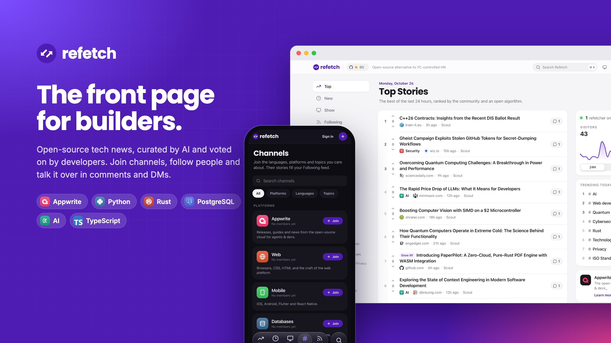

<div align="center">
  <a href="https://refetch.io"></a>

  <br />
  <br />

  **Open-source alternative to YC-controlled HN, featuring curated tech news, discussions, and community-driven content.**

  <br />
  <br />

  [](https://tanstack.com/start)
  [](https://appwrite.io/)
  [](https://www.typescriptlang.org/)
  [](https://tailwindcss.com/)
</div>

---

**Refetch** was born from a simple yet powerful idea: create a modern, open-source alternative to Hacker News that combines the best of community-driven curation with intelligent AI-powered content discovery. Free from YC-control, open and transparent, doesn't favor anyone.

{{news}}

### What We're Building

- **🤖 AI-Powered Discovery**: Our intelligent scout functions automatically discover high-quality tech content from leading sources so you can be lazy and enjoy
- **🎯 Quality Curation**: Advanced algorithms analyze and rank content based on relevance, quality, and community value
- **#️⃣ Channels**: Reddit-style channels for Appwrite, Python, PHP, Ruby, Rust, AI and more, each fed by its own sources. Join the ones you care about and their best stories gather in your **Following** feed
- **⌘K Command center**: Search stories, jump to channels and pages, or switch appearance from anywhere
- **👤 Profiles & follows**: Public profiles with photos from Appwrite Avatars, karma and history. Follow people and their stories join your Following feed
- **💬 Messages**: Direct messages and group chats with replies, reactions, read receipts, shared stories, mute and block
- **🌍 Global Reach**: Multilingual support with AI-powered translations in 12+ languages
- **🔒 Privacy-First**: Built on Appwrite's secure, self-hostable backend infrastructure
- **📱 Modern UX**: An Apple-inspired, server-rendered interface with dark mode — the opposite of HN
- **🚀 Open Source**: 100% open source, community-driven

### Why Refetch?

While Hacker News has been the go-to platform for tech discussions for years, we believe there's room for innovation. Refetch brings:

- **Better Content Discovery**: AI algorithms that surface the most relevant tech news
- **Enhanced User Experience**: Modern, mobile-first design that works everywhere
- **Community Empowerment**: Open source codebase that anyone can contribute to
- **Transparent Algorithms**: Clear, documented ranking systems you can understand and improve

---

## 🏗️ Architecture Overview

### Web app

- **[TanStack Start](https://tanstack.com/start)** — React 19 with streaming SSR, file-based routing (TanStack Router) and type-safe server functions. Data is prefetched in route loaders and cached with TanStack Query.
- **Design system** — Apple-inspired tokens and components on Tailwind CSS v4 and Radix primitives, in light and dark mode. See [`DESIGN.md`](DESIGN.md).
- **TypeScript** end to end (strict).

### Backend — Appwrite

- **Tables DB** — `posts`, `comments`, `votes`, `daily_topics` and `topics`, plus `channels` and `channel_members` for channels, `profiles`, `user_follows` and `user_blocks` for people, and `conversations`, `conversation_members`, `messages` and `message_reactions` for messages. The web app reads and writes them on the server with an API key, exactly as before (same tables, columns, counters and rate limits; posts gain an optional `channel` column).
- **Authentication** — email & password and **Continue with Appwrite** (Appwrite as an OAuth2 provider). Sessions are created on the server and stored in an `httpOnly` cookie (Appwrite's SSR pattern), so pages render signed-in on the first byte.
- **Avatars** — site favicons and profile photos (`/avatars/photo`: uploaded photo, OAuth picture, Gravatar, then initials).
- **Functions** — Scout, Enhancement, Algorithm, Topic stats and Readme (unchanged), plus Channels, in [`functions/`](functions).
- **Sites** — hosting with SSR.

### AI-Powered Features

- **Content Scout**: Automatically discovers tech articles from 20+ sources
- **Content Enhancement**: AI analysis for quality scoring, categorization, summaries and optimization
- **Smart Ranking**: Multi-factor algorithm considering time, quality, and community engagement
- **Multilingual Support**: AI-powered translations and language detection

---

## 📁 Project Structure

```
refetch/
├── src/
│   ├── routes/                # File-based routes (TanStack Router)
│   │   ├── _app/              # Feeds, channels, threads, submit (app shell)
│   │   ├── _auth/             # Sign in / sign up
│   │   ├── auth/callback.ts   # "Continue with Appwrite" OAuth callback
│   │   └── api/og/            # Social images (/api/og/thread/:id)
│   ├── api/                   # Server functions (RPC) called by the UI
│   ├── server/                # Server-only Appwrite code (*.server.ts)
│   ├── components/
│   │   ├── ui/                # Design system primitives
│   │   └── …                  # Feature components (feed, channels, thread, insights, layout, command center)
│   ├── lib/                   # Shared types, queries, utilities
│   └── styles/app.css         # Design tokens (Tailwind v4 @theme)
├── functions/                 # Appwrite Functions
│   ├── scout/                 # Content discovery automation
│   ├── enhancement/           # AI content analysis
│   ├── algorithm/             # Ranking algorithm
│   ├── topic-stats/           # Topic ranking (scheduled)
│   ├── channels/              # Pulls each channel's sources (scheduled)
│   └── readme/                # Syncs top posts into GitHub README
├── scripts/appwrite-setup.mjs # Creates/updates tables, indexes and function shells
├── scripts/channels.json      # Channel catalog: names, colors, keywords and sources
├── scripts/channel-icons/     # Channel icons (PNG), uploaded to Storage by appwrite:setup
├── extensions/                # Browser extension
├── public/                    # Static assets
└── DESIGN.md                  # Design system guide
```

---

## 🚀 Getting Started

### Prerequisites

- Node.js 22+
- pnpm (recommended) or npm
- An Appwrite project (Cloud or self-hosted)

### Quick Start

1. **Clone the repository**
   ```bash
   git clone https://github.com/refetch-io/refetch.git
   cd refetch
   ```

2. **Install dependencies**
   ```bash
   pnpm install
   ```

3. **Set up environment variables**
   ```bash
   cp env.example .env
   ```
   Fill it in using [Environment variables](#environment-variables) as a checklist.

4. **Run the development server**
   ```bash
   pnpm dev
   ```

5. **Open your browser** at [http://localhost:3000](http://localhost:3000)

### Scripts

| Script | What it does |
| --- | --- |
| `pnpm dev` | Start the dev server on port 3000 |
| `pnpm build` | Run `appwrite:setup`, then build the app (used by Appwrite Sites) |
| `pnpm build:app` | Build the app only |
| `pnpm preview` | Serve the production build locally |
| `pnpm typecheck` | Type-check the project |
| `pnpm format` | Format with Prettier (Tailwind classes sorted) |
| `pnpm appwrite:setup` | Create or update the database, tables, indexes and function shells |

---

## Environment variables

**Where to set them**

- **Web app (local / Appwrite Sites):** `.env` locally, or the site's environment variables. Everything is read on the server — nothing is exposed to the browser except the Appwrite endpoint and project ID (needed for favicons).
- **Appwrite Functions:** set variables in the Console. Define shared keys once as **[global (project) variables](https://appwrite.io/docs/products/functions/environment-variables)** so every function inherits them; use per-function variables only to override or add keys.
- The previous `NEXT_PUBLIC_APPWRITE_ENDPOINT`, `NEXT_PUBLIC_APPWRITE_PROJECT_ID` and `NEXT_PUBLIC_BASE_URL` names are still honored, so existing deployments keep working.

Table IDs use the legacy name `*_COLLECTION_ID` but refer to **Appwrite Tables** table IDs.

### 1. Appwrite connection (global)

| Variable | Description |
| --- | --- |
| `APPWRITE_ENDPOINT` | REST API base (e.g. `https://fra.cloud.appwrite.io/v1`). |
| `APPWRITE_PROJECT_ID` | Project ID. |
| `APPWRITE_API_KEY` | Server API key. The web app needs table/row access **and `sessions.write`** (sign-in, sign-up, Continue with Appwrite). |

### 2. Appwrite data IDs (global)

| Variable | Description |
| --- | --- |
| `APPWRITE_DATABASE_ID` | Tables DB database ID. |
| `APPWRITE_POSTS_COLLECTION_ID` | `posts` table. |
| `APPWRITE_COMMENTS_COLLECTION_ID` | `comments` table. |
| `APPWRITE_VOTES_COLLECTION_ID` | `votes` table. |
| `APPWRITE_KEYS_COLLECTION_ID` | `keys` table (personal API keys; secrets encrypted). |
| `APPWRITE_DAILY_TOPICS_COLLECTION_ID` | `daily_topics` table (topic stats). Defaults to `daily_topics`. |
| `APPWRITE_TOPICS_COLLECTION_ID` | `topics` table (topic stats). |
| `APPWRITE_CHANNELS_COLLECTION_ID` | `channels` table. Defaults to `channels`. |
| `APPWRITE_CHANNEL_MEMBERS_COLLECTION_ID` | `channel_members` table (who joined what). Defaults to `channel_members`. |
| `APPWRITE_CHANNEL_ICONS_BUCKET_ID` | Public Storage bucket for channel icons (PNG). Defaults to `channel-icons`. |
| `APPWRITE_PROFILES_COLLECTION_ID` | `profiles` table (name, bio, website, who can message you). Defaults to `profiles`. |
| `APPWRITE_FOLLOWS_COLLECTION_ID` | `user_follows` table. Defaults to `user_follows`. |
| `APPWRITE_BLOCKS_COLLECTION_ID` | `user_blocks` table. Defaults to `user_blocks`. |
| `APPWRITE_CONVERSATIONS_COLLECTION_ID` | `conversations` table (direct and group). Defaults to `conversations`. |
| `APPWRITE_CONVERSATION_MEMBERS_COLLECTION_ID` | `conversation_members` table (read state, unread counts, mute). Defaults to `conversation_members`. |
| `APPWRITE_MESSAGES_COLLECTION_ID` | `messages` table. Defaults to `messages`. |
| `APPWRITE_MESSAGE_REACTIONS_COLLECTION_ID` | `message_reactions` table. Defaults to `message_reactions`. |

### 3. Web app

| Variable | Description |
| --- | --- |
| `SITE_URL` | Canonical public origin for SEO metadata and social cards (default `https://refetch.io`). |
| `PLAUSIBLE_API_KEY` | Optional. Powers “refetchers online” and the visitors chart. |
| `APPWRITE_ANALYTICS_PROPERTY_ID` | Optional. Appwrite Analytics property; pageviews and custom events are sent alongside Plausible, from production hosts only. |
| `PLAUSIBLE_SITE_ID` | Optional. Plausible site ID (e.g. `refetch.io`). |

### 4. OpenAI (global for AI functions)

| Variable | Description |
| --- | --- |
| `OPENAI_API_KEY` | Scout and Enhancement. |
| `OPENAI_MODEL` | OpenAI chat model for Scout and Enhancement; set as a **global** project variable (optional; default `gpt-4o-mini`). |

### 5. Scout-only (sources)

Actor identity, LLM batching, scraping delays, and per-run limits are **constants** in `functions/scout/index.js` (not environment variables).

| Variable | Description |
| --- | --- |
| `SCOUT_TARGET_WEBSITES` | Comma-separated site roots to crawl (can be very long). |

### 6. Readme function only

| Variable | Description |
| --- | --- |
| `README_ORIGIN` | Public origin for links in generated `README.md` (default `https://refetch.io`). |
| `README_GITHUB_TOKEN` | PAT with `contents: write` (or equivalent) to update `README.md`. |
| `README_GITHUB_OWNER` | Owner (user or org). |
| `README_GITHUB_REPO` | Repository name. |
| `README_GITHUB_BRANCH` | Branch to commit on (default `main`). |

**Bootstrap (`scripts/appwrite-setup.mjs`):** `npm run build` runs this first; it uses the same **Appwrite connection** and **data IDs** to create or update the database, tables, indexes, and function shells (not deployments or function env).

### Which parts need which groups

| Part | Groups |
| --- | --- |
| **Web app** | 1, 2, 3 |
| **Scout** | 1, 2, 4, 5 |
| **Enhancement** | 1, 2, 4 |
| **Algorithm** | 1, 2 (posts only) |
| **Topic stats** | 1, 2 (incl. daily_topics + topics) |
| **Channels** | 1, 2 (posts + channels) |
| **Readme** | 1, 2 (posts only), 6 |

---

## 🔐 Appwrite setup checklist

1. **API key scopes** — `rows.read`, `rows.write`, `tables.read` for the feeds, votes and comments, plus **`sessions.write`** so the server can create sessions. Without it, sign-in shows *“the server API key needs the sessions.write scope”*.
2. **Continue with Appwrite** — in *Auth → Settings → OAuth2 providers*, enable **Appwrite**. The callback path is `/auth/callback`.
3. **Platforms** — add a Web platform for each hostname the site runs on (e.g. `refetch.io`, `localhost`) so OAuth redirects are accepted.
4. **People & messages** — `pnpm appwrite:setup` also creates the profile, follow, block and messaging tables. Profiles are written when people sign in (the server key doesn't need `users.read`); people who haven't signed in since are shown from their posts and comments. Messages refresh by polling (every few seconds in an open conversation).
5. **Channels** — `pnpm appwrite:setup` adds the `posts.channel` column, creates `channels` and `channel_members`, seeds the catalog from [`scripts/channels.json`](scripts/channels.json) (member counts are kept), uploads each icon from [`scripts/channel-icons`](scripts/channel-icons) to the public `channel-icons` bucket and creates the scheduled **Channels** function. Deploy [`functions/channels`](functions/channels) to start the content flowing. Until the setup runs, the app serves the bundled catalog and matches stories by topic, but joining is unavailable.

## ☁️ Deploying to Appwrite Sites

| Setting | Value |
| --- | --- |
| Framework | TanStack Start |
| Install command | `pnpm install` (or `npm install`) |
| Build command | `npm run build` |
| Output directory | `./dist` |

Add the environment variables above to the site. `npm run build` runs `appwrite:setup` first; use `build:app` instead if you don't want the build to touch your Appwrite schema.

---

## 🎨 Design system

Refetch's UI follows a small, Apple-inspired design system: semantic color tokens (light + dark), Poppins titles over the SF Pro type scale, inset grouped lists, frosted materials and spring-based motion — all on the original Refetch purple. Read [`DESIGN.md`](DESIGN.md) for guidelines. A live component catalog runs at `/design` in every environment; it is unlisted and not indexed.

---

## 🤝 Contributing

**Refetch was initially 100% vibe-coded, but we're excited to welcome contributions from humans too!**

We believe in the power of community-driven development and welcome all types of contributions:

### How to Contribute

1. **Fork the repository**
2. **Create a feature branch**
   ```bash
   git checkout -b feature/amazing-feature
   ```
3. **Make your changes**
4. **Test thoroughly** (`pnpm typecheck && pnpm build:app`)
5. **Submit a pull request**

---

## 🔧 Appwrite Functions

Refetch uses several Appwrite serverless functions for automated content processing:

### Scout Function
Automatically discovers high-quality tech content from 20+ sources including TechCrunch, The Verge, Ars Technica, and more.

### Enhancement Function
AI-powered content analysis that generates metadata, quality scores, summaries and multilingual translations.

### Algorithm Function
Sophisticated ranking algorithm that considers time decay, quality metrics, and community engagement.

### Topic stats function
Scheduled job that aggregates post data into `daily_topics` and `topics` tables (see [Environment variables](#environment-variables)). Until it runs, the web app computes “Trending today” live from the last 24 hours of posts.

### Channels function
Runs every two hours (at :15). For each channel in `channels`, it reads the official feeds first (blogs, release notes, GitHub releases), falls back to community feeds (mostly DEV tags) when those have nothing new, and posts at most one fresh story per channel as Scout, tagged with that channel. Enhancement then scores and summarizes it like any other story. Stories also reach channels when their AI topics match a channel's keywords. To add a channel, add it to [`scripts/channels.json`](scripts/channels.json), drop a square PNG icon (256×256, full bleed; the app rounds the corners) at `scripts/channel-icons/<id>.png` and run `pnpm appwrite:setup`. You can also upload an icon to the `channel-icons` bucket in the Console and put its file ID in the channel's `icon` column.

### Readme function
Commits an auto-generated “top posts” section into this repository’s `README.md` using the GitHub API.

---

## 📄 License

This project is licensed under the MIT License - see the [LICENSE](LICENSE) file for details.

---

<div align="center">
  <p><strong>Made with ❤️ for the Refetch community</strong></p>
</div>
